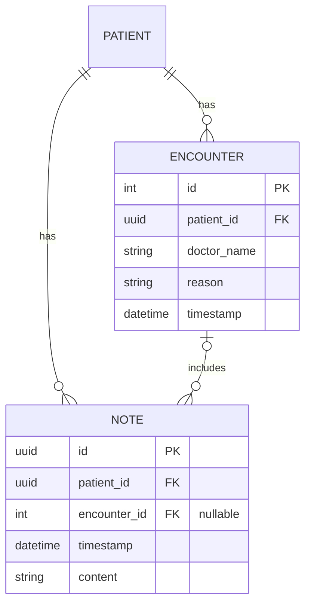

# Encounters

Each encounter belongs to exactly one patient. A patient can have zero or many encounters. Each note belongs to a patient and can optionally link to one encounter for that same patient.



`patient_id` uses the existing patient UUID type. Encounter IDs are generated integers. The API derives ownership from the patient URL; callers cannot change it through a request body.

## Requests

Create an encounter with `POST /patients/{patient_id}/encounters`:

```json
{
  "doctor_name": "Dr. Morgan Lee",
  "reason": "Annual checkup",
  "timestamp": "2024-06-10T14:30:00Z"
}
```

The `201` response includes the generated integer `id`, the `patient_id`, and all three editable fields. Doctor names are trimmed and must contain 1–100 characters; reasons are trimmed and must contain 1–10,000 characters. Timestamps are normalized to UTC; timestamps without an offset are treated as UTC. As with notes, a timestamp cannot be more than 60 seconds in the future.

`GET /patients/{patient_id}/encounters` returns an array ordered by timestamp descending, then ID ascending. `GET`, `PUT`, and `DELETE /patients/{patient_id}/encounters/{encounter_id}` retrieve, replace, and delete an encounter. `PUT` requires all three editable fields. Missing encounters and encounters owned by another patient return `404`; invalid bodies or IDs return `422`.

Create a linked note through the existing `POST /patients/{patient_id}/notes` endpoint:

```json
{
  "timestamp": "2024-06-10T14:35:00Z",
  "content": "Patient requested an appointment reminder.",
  "encounter_id": 1
}
```

Use the ID returned by encounter creation. Omit `encounter_id` or send `null` for a standalone patient note. Note responses include `encounter_id`. To list an encounter's notes, use `GET /patients/{patient_id}/notes?encounter_id=1`. Both operations return `404` if the encounter is missing or belongs to another patient.

Deleting an encounter sets its notes' `encounter_id` to `null`, keeping their patient link and content. Deleting a patient cascades to all of their encounters and notes. The frontend API client exposes these operations; encounter management screens are not part of this change.

## Existing databases

Alembic now manages this schema. Fresh databases include encounter tables and note links in `0001_initial`; application startup checks the migration revision without changing tables. Existing unversioned databases must be validated and explicitly baselined as described in [migrations.md](migrations.md). Patients and notes are preserved during adoption. Pre-encounter databases require the documented additive update before validation and stamping.

The prior additive PostgreSQL SQL is retained in [003_encounters.sql](../backend/sql/003_encounters.sql) as a legacy adoption aid. Use Alembic for new provisioning; do not apply both provisioning methods to the same fresh database.
